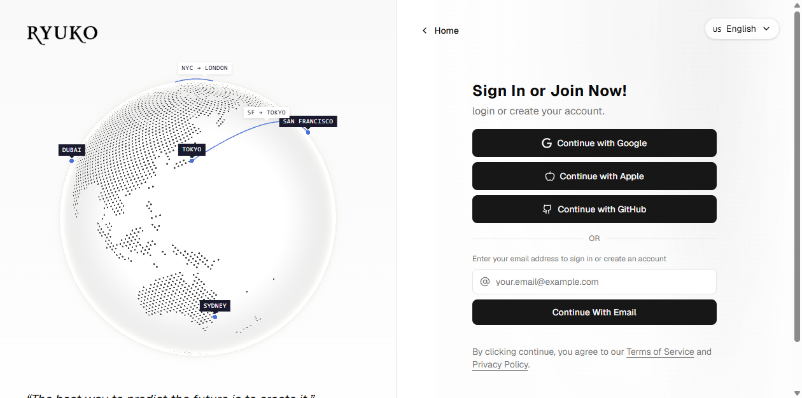

# Ryuko — Tela de Login

🔗 **Demonstração:** [https://ryuko-login.vercel.app](https://ryuko-login.vercel.app)



Página de login responsiva construída com Next.js, React, TypeScript e Tailwind CSS. O lado esquerdo mostra um globo 3D interativo com pontos turísticos e rotas, uma citação e a logo da Ryuko. O lado direito contém o formulário de acesso, com login social, validação de e-mail e troca de idioma.

## Funcionalidades

- Globo 3D animado (Cobe) com marcadores e rotas entre cidades.
- Login com Google, Apple, GitHub e e-mail (com validação e mensagens de erro/sucesso).
- Seletor de idioma com 13 opções: English, 简体中文, 繁體中文, 日本語, Español, Français, Português (BR), 한국어, Русский, Türkçe, Bahasa Indonesia, Deutsch e فارسی.
- Layout responsivo: o painel do globo fica oculto em telas menores que `lg`.
- Animações de entrada e efeitos de hover e foco nos botões e campos.

## Tecnologias

- [Next.js](https://nextjs.org) 16 (App Router)
- [React](https://react.dev) 19
- [TypeScript](https://www.typescriptlang.org)
- [Tailwind CSS](https://tailwindcss.com) 4
- [shadcn/ui](https://ui.shadcn.com) (estrutura de componentes em `components/ui`)
- [Cobe](https://cobe.vercel.app) (globo 3D)
- [lucide-react](https://lucide.dev) (ícones)

## Como executar

Pré-requisitos: Node.js 20 ou superior.

```bash
npm install
npm run dev
```

Abra [http://localhost:3000](http://localhost:3000) no navegador para ver a versão local. Para ver a versão publicada, use o link da demonstração no topo deste README.

Outros comandos:

```bash
npm run build   # gera a versão de produção
npm run start   # inicia a versão de produção
npm run lint    # executa o ESLint
```

## Estrutura

```
app/                  páginas, layout e estilos globais (globals.css)
components/ui/        AuthPage, globo, seletor de idioma e componentes base
lib/i18n.ts           textos traduzidos para os 13 idiomas
lib/utils.ts          utilitários (cn)
public/               imagens e logos
```

## Licença

Todos os direitos reservados © Ryuko. Este repositório é disponibilizado apenas para visualização, como portfólio. Não é permitido copiar, modificar, distribuir ou reutilizar o código sem autorização prévia por escrito. Veja o arquivo [LICENSE](./LICENSE).

Componentes de terceiros mantêm as licenças de seus autores originais.

Ryuko © 2026. Todos os direitos reservados.
